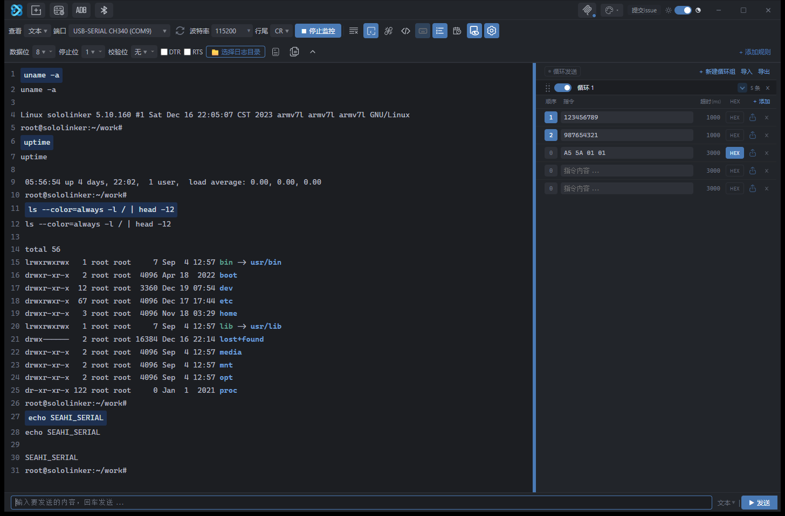
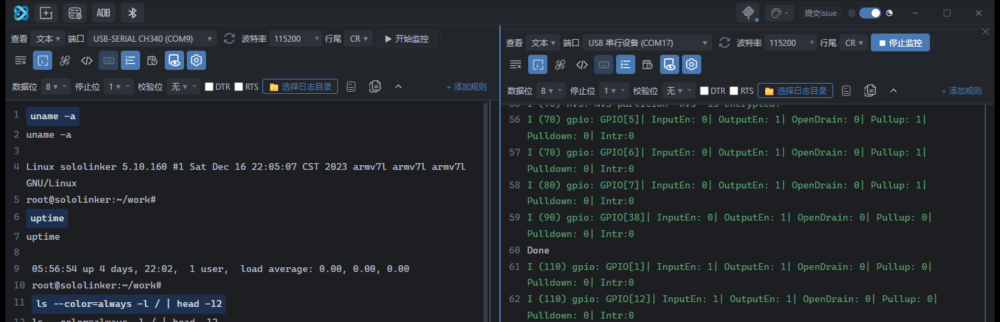

# SeaHi Serial

<div align="center">


</div>

一款基于 **Tauri 2 + Rust** 的 Windows 串口 / 蓝牙调试工具：多串口分栏、xterm 真终端、蓝牙 GATT、ADB、WSL 端口映射，内置 MCP 服务器让 AI 直接操作。

<div align="center">

### 📖 [完整文档 · 截图与录屏](https://www.seahi-serial.c-hi.cn/)

<sub>www.seahi-serial.c-hi.cn · 本 README 只做入口，详细教程都在文档站</sub>

  

</div>

## 主要功能

- **多串口分栏** — 同窗口开多个监视器，每个分栏独立端口、波特率、行尾与发送历史
- **终端模式** — 输出区切成 xterm：`vi` / `top` 可用，方向键与 Ctrl 组合键原样发给设备
- **快速指令** — 一组一张表，可按顺序号循环、等待设备回话（超时 / 重试 / 跳转），也可挂到外部文件双向写回
- **蓝牙 GATT** — 扫描 / 连接 / 浏览服务树，读写特征与描述符，CTS 时间就地翻成人话
- **WSL 与 ADB** — USB 串口映射进 WSL 并直接调试；ADB 设备列表、终端与命令下发
- **内置 MCP 服务器** — Claude Code / Cursor 等 AI 客户端可读日志、发指令、操作界面

## 下载

打开 **[官网首页](https://www.seahi-serial.c-hi.cn/)**，点「下载安装包」即可；按钮旁的版本下拉可以选旧版本。首页暂时打不开时，可直接从 [Releases](https://github.com/SeaHi-Mo/Seahi-Serial/releases) 下载。

> ⚠️ 安装包**暂未做代码签名**，Windows SmartScreen 可能提示「未知发布者」——这是未签名程序的正常提示，不等于病毒。
> 校验方式见 [代码签名与安装说明](./doc/SIGNING.md)：Release 附带 `SHA256SUMS.txt` 与 cosign keyless 签名（`.sigstore.json`），验签命令见该文档 §4.1。

## 文档

| 想做什么 | 看这里 |
|---|---|
| 装上、连第一个串口、发第一条命令 | [快速开始](https://www.seahi-serial.c-hi.cn/guide/quick-start) |
| 多分栏、DTR/RTS、日志与断线重连 | [串口调试](https://www.seahi-serial.c-hi.cn/guide/serial) |
| 用终端模式跑 shell / TUI | [终端模式](https://www.seahi-serial.c-hi.cn/guide/terminal) |
| 循环发送、等待回话、挂外部文件 | [快速指令](https://www.seahi-serial.c-hi.cn/guide/quick-cmds) |
| 把 USB 串口映射进 WSL | [WSL 端口映射](https://www.seahi-serial.c-hi.cn/guide/wsl) |
| 蓝牙扫描、连接与 GATT 读写 | [蓝牙调试](https://www.seahi-serial.c-hi.cn/guide/ble) |
| ADB 设备、终端与命令 | [ADB 调试](https://www.seahi-serial.c-hi.cn/guide/adb) |
| 让 AI 接入并操作本程序 | [MCP 接入](https://www.seahi-serial.c-hi.cn/guide/mcp) · [54 个工具参考](https://www.seahi-serial.c-hi.cn/mcp/tools) |
| 换主题、常见问题 | [主题](https://www.seahi-serial.c-hi.cn/guide/theme) · [常见问题](https://www.seahi-serial.c-hi.cn/guide/faq) |

## 开发

依赖、构建、测试、目录结构与提交 PR 的要求都在开发指南里：

- **[开发指南](https://www.seahi-serial.c-hi.cn/dev/)** — 环境依赖、`npm run dev/build`、三套测试、目录结构
- **[技能（skills）](https://www.seahi-serial.c-hi.cn/dev/skills)** — 仓库 `skills/` 是写给 AI 助手的开发手册，改代码前先让助手读一遍
- **[提交 PR](https://www.seahi-serial.c-hi.cn/dev/#提交-pr)** — 前提条件与标题 / 描述要求

改代码前请先读 [`AGENTS.md`](./AGENTS.md)：MCP、BLE、窗口几何、终端模式等硬约束都在里面。

```bash
npm install     # 依赖（只有 @tauri-apps/cli）
npm run dev     # 开发模式（热重载）
npm run build   # 发布构建 → src-tauri/target/release/seahi-serial.exe
```

## License

MIT
